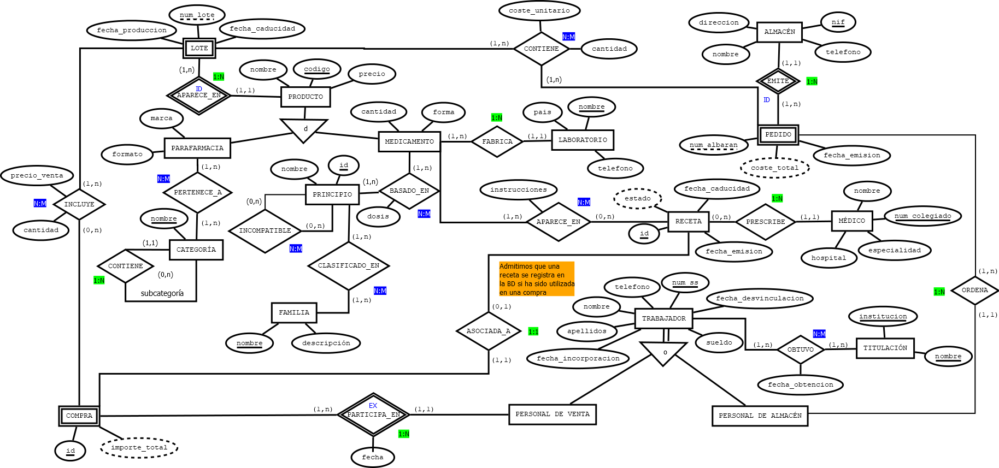
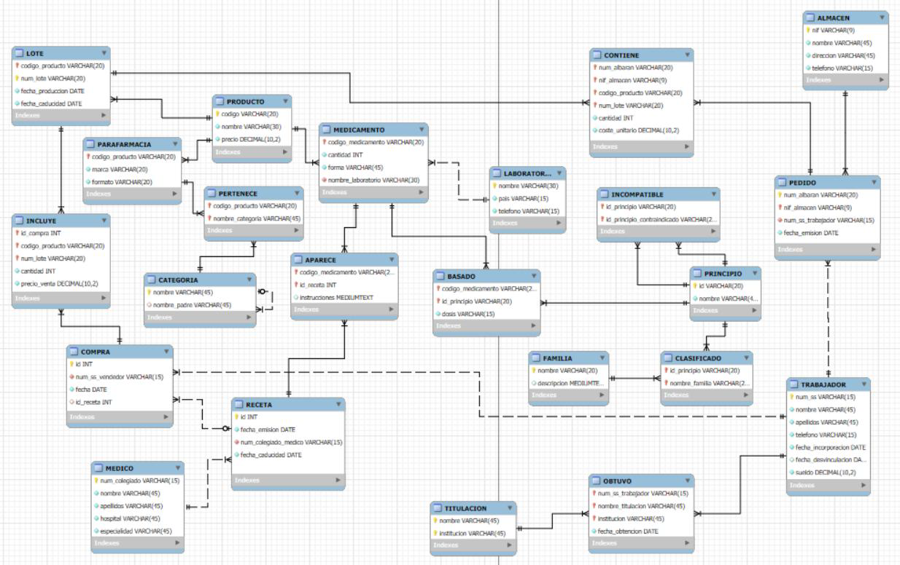

# Sistema de Gestión para una Farmacia Ficticia

**Trabajo Final — Bases de Datos**  
Curso 2025–2026

**Autor:**
José Martín-Zamorano Silva

---

## 1. Descripción del proyecto

En este repositorio se aporta el código y los esquemas necesarios para el diseño, implementación y despliegue de un sistema integral de gestión para una farmacia.

El proyecto abarca todo el flujo de desarrollo de bases de datos y su integración con una aplicación web:

- diseño conceptual (diagrama Entidad-Relación);



- diseño lógico (paso al modelo relacional);
- implementación en un Sistema de Gestión de Bases de Datos Relacionales (MySQL);



- implementación en un modelo NoSQL orientado a documentos (MongoDB);
- desarrollo de un servidor backend en Node.js;
- despliegue de una aplicación web interactiva orientada tanto a clientes como a la administración del negocio.

La aplicación web se divide en dos vistas principales:

- **Vista de cliente:** orientada a usuarios interesados en consultar de manera visual el catálogo de productos (medicamentos y parafarmacia), información sobre laboratorios, principios activos y la plantilla de profesionales.
- **Vista de administrador:** simula el software interno de la farmacia, permitiendo registrar ventas (con o sin receta), tramitar pedidos a almacenes, gestionar el stock y administrar los datos de los empleados.

---

## 2. Problema abordado

La correcta gestión de una farmacia requiere un control estricto del inventario, la trazabilidad de los medicamentos, la interacción con proveedores y el registro de ventas asociadas a prescripciones médicas.

El objetivo principal del proyecto es poder gestionar este ecosistema respondiendo a necesidades complejas, tales como:

> ¿Cómo mantener la integridad referencial al registrar ventas, asociar recetas médicas y verificar incompatibilidades de principios activos en tiempo real?

Para ello, la base de datos y la aplicación manejan variables e identidades clave, destacando:

- **Productos:** clasificados exhaustivamente en medicamentos y parafarmacia, controlando stock, precio, formato, lotes, fechas de producción y caducidad.
- **Ámbito médico:** médicos prescriptores, laboratorios fabricantes y recetas.
- **Seguridad clínica:** registro de familias farmacológicas, principios activos y sus **incompatibilidades** (con el objetivo de alertar al usuario al vender conjuntamente principios contraindicados).
- **Gestión comercial:** almacenes proveedores, emisión de pedidos y albaranes.
- **Personal:** control de empleados (venta y almacén), titulaciones y rendimiento comercial.

---

## 3. Estructura

El proyecto está organizado en distintos módulos orientados a la base de datos y al desarrollo web:

- `dbs/` → esquemas y scripts de las bases de datos:
  - `mysql/` → diagrama `.mwb`, scripts de creación de tablas (`farmacia.sql`) e inserción de datos (`insercion_farmacia.sql`).
  - `mongodb/` → scripts de inserciones (`inserciones_producto.js`, `inserciones_principio.js`) y colecciones en formato JSONArray (`Productos.json` y `Principio.json`).
- `imagenes/` → imágenes para la página web.
- `farmacia.html` → código de la interfaz web.
- `server.js` → código del servidor en Node.js para la conexión con las bases de datos.
- `estilos.css` → hoja de estilo `.css` para aspectos visuales de la web.

---

## 4. Entorno de ejecución

Para desplegar la aplicación web y conectarla a las bases de datos, es necesario contar con Node.js y los motores de base de datos en ejecución (MySQL y MongoDB en local).

Para inicializar el proyecto en Node.js, ejecuta en la terminal dentro de la carpeta raíz:

```bash
npm init -y
```

---

## 5. Instalación de dependencias

El backend en Node.js requiere de ciertos paquetes para levantar el servidor y conectar con los diferentes motores de base de datos. Instala las dependencias ejecutando:

```bash
npm install express cors mysql2 mongodb
```

---

## 6. Ejecución del proyecto

Para ejecutar el flujo completo y levantar el servidor web:

### 6.1. Conexión a las Bases de Datos

**MySQL (vía XAMPP)**

1. Abre el panel de control de XAMPP e inicia el módulo de **MySQL** (y **Apache** si vas a usar phpMyAdmin).

2. Abre tu gestor de bases de datos (puedes usar MySQL Workbench o acceder a `http://localhost/phpmyadmin` en tu navegador).

3. Importa los scripts que se encuentran en la carpeta `dbs/mysql`:
   - Primero, ejecuta el archivo `farmacia.sql` para crear la estructura relacional.
   - A continuación, ejecuta `inserciones.sql` para poblar las tablas con los datos de prueba.

**MongoDB**

1. Abre una terminal e introduce:

```bash
mongod
```

2. Abre una nueva terminal desde la carpeta `dbs/mongodb` e importa las colecciones desde los archivos JSON ejecutando los siguientes comandos:

```bash
mongoimport -d farmacia -c producto --file Productos.json --jsonArray
mongoimport -d farmacia -c principio --file Principio.json --jsonArray
```

3. Una vez iniciada la conexión e importados los datos, introducir en el gestor correspondiente la orden:

```bash
use farmacia
```

### 6.2. Ejecutar el servidor

Introduce en una terminal desde la carpeta del proyecto:

```bash
node server.js
```

o, en caso de tener instalado `nodemon`:

```bash
nodemon server.js
```

---

## 7. Aplicación web

La aplicación web utiliza Bootstrap 5 para el diseño (cuadrículas, tarjetas, barras de navegación) y CSS personalizado. Permite las siguientes funcionalidades dinámicas conectadas de forma asíncrona a las BDs:

**Funcionalidades de Cliente:**

- **Catálogo:** filtrado y búsqueda de productos. Si un producto carece de imagen, se le asigna una imagen por defecto (conexión a MongoDB).
- **Laboratorios:** consulta de datos del laboratorio y tabla con los 3 medicamentos más vendidos (conexión a MySQL).
- **Principios:** visualización de familias farmacológicas, medicamentos basados en ellas y listado de principios incompatibles (conexión a MySQL).
- **Plantilla:** visualización de empleados activos y sus titulaciones (conexión a MySQL).

**Funcionalidades de Administrador:**

- **Compras:** "carrito de compra" que verifica el stock disponible de los productos, solicita instrucciones si hay recetas vinculadas y emite **alertas de incompatibilidades** entre medicamentos (por ejemplo, Ácido acetilsalicílico e Ibuprofeno) en tiempo real.
- **Pedidos:** gestión de proveedores activos/inactivos y tabla de los 5 productos con menor stock.
- **Empleados:** estadísticas de masa salarial, top 3 empleados con más ventas, y formularios para altas, bajas y modificaciones.

---

## 8. Reproducibilidad

A modo de resumen, el proyecto puede reproducirse completamente siguiendo estos pasos:

1. Importar el modelo relacional ejecutando `farmacia.sql` e `inserciones.sql` en MySQL.
2. Crear las colecciones e insertar los documentos en MongoDB usando los scripts proporcionados en la carpeta correspondiente.
3. Instalar las dependencias de Node (`npm install`).
4. Configurar las credenciales locales de base de datos en el servidor web.
5. Iniciar la aplicación: `node server.js`.
6. Abrir `http://localhost:3000` (o el puerto configurado) en el navegador.

---

## 9. Observaciones

- **Volumen de datos:** Debido al alto volumen real de una farmacia, se ha utilizado una muestra representativa (aprox. 100 productos) para evitar sobrecargas computacionales, con datos de ventas, pedidos y lotes generados mediante Inteligencia Artificial para garantizar la integridad referencial.
- **Diseño NoSQL (MongoDB):** Se aplicó el enfoque _one-way embedding_ para la relación `BASADO` (embebiendo `PRINCIPIO` dentro de `MEDICAMENTO`) y referencias manuales para las relaciones reflexivas como `INCOMPATIBLE`.

**_Nota 1:_** _Los registros asociados a empleados y profesionales de la salud en el presente proyecto son de naturaleza ficticia, elaborados con el objetivo de ilustrar el sistema. Toda coincidencia con la realidad resulta meramente accidental._

**_Nota 2:_** _Los registros de la base de datos fueron actualizados por última vez en junio de 2026. Esto puede afectar a algunas funcionalidades de la página web._
